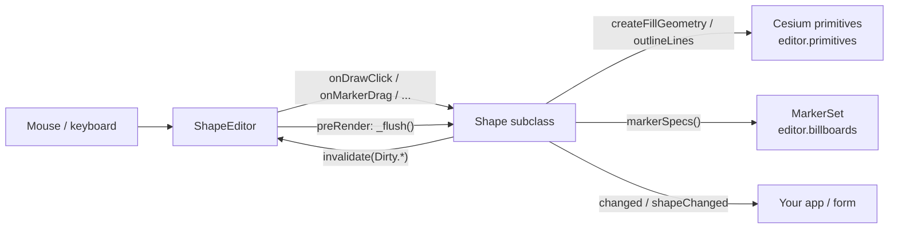

# Shape library: onboarding guide

How `src/shapes/` works, for engineers who will change it or add shapes to it. For *using* the
library (options, each shape's behavior, the API at a glance), start with the "Shape library"
section of the [README](../../README.md). This guide explains the parts behind it.

To rebuild the library or the demo from scratch (for example, with another model), see the
step-by-step plans in this folder: [`01-shape-library.md`](01-shape-library.md) and
[`02-shapes-demo.md`](02-shapes-demo.md).

Try it first: `npm install`, `npm run dev`, open `/shapes.html`. Draw a few shapes, click one to
edit it, drag its markers, hold shift while dragging, and watch the right-hand form update.

## Contents

1. [The pieces](#1-the-pieces)
2. [A shape's life](#2-a-shapes-life)
3. [Rendering: dirty flags and the frame flush](#3-rendering-dirty-flags-and-the-frame-flush)
4. [Input: from mouse event to shape hook](#4-input-from-mouse-event-to-shape-hook)
5. [Markers](#5-markers)
6. [Fields, change events and JSON](#6-fields-change-events-and-json)
7. [Materials](#7-materials)
8. [Geodesy helpers and conventions](#8-geodesy-helpers-and-conventions)
9. [Adding a shape](#9-adding-a-shape)
10. [Gotchas](#10-gotchas)

## 1. The pieces

| File | What it is |
|---|---|
| `ShapeEditor.js` | One per viewer. Owns mouse/keyboard input, the shape being drawn, the selected (edited) shape, the shared primitive and billboard collections, and the once-per-frame rebuild. |
| `Shape.js` | Base class. Holds the common state (arc type, clamp/height, outline, fill, marker options), turns a subclass's geometry into Cesium primitives, and defines the hooks subclasses implement. Also `Dirty`, the shape registry, `validateField` and the degree helpers. |
| `ShapeMode.js` | `DRAW`, `EDIT`, `IDLE`. |
| `Markers.js` | `MarkerSet`: the edit handles of one shape as billboards, plus their looks (`DEFAULT_MARKER_OPTIONS`, `DEFAULT_ROLE_STYLES`, the SVG images). |
| `VertexShape.js` | Base for shapes made of a vertex list (click to add, double-click to finish, deletable vertices, double-click an edge to insert). |
| `Polyline.js`, `Polygon.js`, `Corridor.js` | `VertexShape` subclasses. `corridorGeometry.js` builds the corridor's footprint and volume. |
| `Circle.js`, `Rectangle.js`, `Sector.js`, `Box.js`, `ParallelLines.js` | Direct `Shape` subclasses with fixed draw steps. |
| `liftedPolygon.js` | Polygon geometry at altitude. |
| `materials.js` | Material *specs* (solid color, Cesium material, the pattern materials) and their JSON. |
| `geodesy.js` | Distances, bearings, destinations, offsets and detail levels, all aware of `arcType`. |
| `index.js` | The public entry point. Importing it also registers every built-in shape type. |

The demo (`shapes.html` + `src/shapesDemo.js`) uses only the public API, so it's a good
reference for how the library is meant to be used.



Who calls whom:
- **The editor calls the shape** for input: the draw hooks, the marker hooks, `_flush()` once per
  frame.
- **The shape never builds primitives right away.** It calls `invalidate(flags)`, which marks it
  dirty with the editor, and the editor flushes it before the next render.
- **The shape owns its primitives and its `MarkerSet`**, but they live in collections the editor
  created (`editor.primitives`, `editor.billboards`, `editor.groundLines`), so one editor can
  remove everything at once.

## 2. A shape's life

```
startDrawing(Class, options) ──► DRAW ──finishDrawing()──► EDIT ◄──select()/click──┐
          │                       │  (only if isValid())    │                       │
          │                       └─cancelDrawing()/Esc──►  removed                 │
          │                                                  └──deselect()/Esc──► IDLE
          └ editor.add(shape) (e.g. from Shape.fromJSON) ─────────────────────────► IDLE
```

- **DRAW.** `editor.startDrawing(Circle, options)` constructs the shape, adds it to the editor
  and puts it in DRAW mode. Clicks go to `onDrawClick(position)`, which returns `"continue"` or
  `"done"`. Mouse moves go to `onDrawMove(position)`, for the live preview. Double-click and
  right-click call `onDrawFinishRequest("double" | "right")`; that's how vertex shapes finish.
  Esc cancels.
- **Finishing.** `finishDrawing()` checks `isValid()`. A valid shape goes to EDIT through the
  editor (`_finishedDrawing` → `select`); an invalid one is removed.
- **EDIT.** Only one shape at a time (`editor.selected`). It has a `MarkerSet`, created in
  `_setMode`, and its markers can be dragged.
- **IDLE.** Drawn, but with no markers. Clicking the shape selects it again.

`shape.interactive` is true while drawing or while a marker is being dragged. Geometry is then
built coarser (`detailFactor`), and when the drag ends the shape is rebuilt at full detail.

## 3. Rendering: dirty flags and the frame flush

Any change calls `invalidate(flags)`, with flags from `Dirty`:

| Flag | Rebuilds |
|---|---|
| `Dirty.FILL` | The fill primitive (`createFillGeometry()`). |
| `Dirty.OUTLINE` | The line primitives (`outlineLines()`). |
| `Dirty.MARKERS` | The billboards (`markerSpecs()` → `MarkerSet.sync`). |
| `Dirty.GEOMETRY` | All three. Use this whenever the shape's defining points change. |

`invalidate` ORs the flags into `shape._dirty` and adds the shape to `editor._dirty`. On the
scene's `preRender`, the editor calls `_flush()` once for each dirty shape, however many mouse
events changed it during that frame. `_flush` then:

1. Rebuilds the fill: `createFillGeometry()` returns one geometry, an array of them, or
   `undefined`. It's built as a `GroundPrimitive` when clamped to the ground, otherwise a
   `Primitive`. Shapes with `static hasFill = false` skip this step.
2. Rebuilds the lines: `outlineLines()` returns `[{ positions, loop?, key?, width?, arcType? }]`.
   Lines with the same `key` and a stateless material share one primitive. Each `key` can have
   its own material (`setLineMaterial(key, material)`); lines without a key use `"outline"`.
3. Updates `boundingSphere`, which is used to skip per-frame material updates for shapes that are
   off screen.
4. Syncs the markers.
5. Raises `shape.changed` and `editor.shapeChanged` (see [§6](#6-fields-change-events-and-json)).

Never build primitives inside a setter or a hook: just set the state and call `invalidate`. Every
setter in the built-in shapes is two lines for this reason.

Everything requests a render, so `requestRenderMode: true` works. The editor keeps requesting
frames while pattern textures or marker SVGs are still loading.

## 4. Input: from mouse event to shape hook

All input is in `ShapeEditor.#bindInput` and the private `#on…` handlers.

**Picking.** `scene.pick` ids are `{ shape, key, kind: "marker" | "delete" }` for billboards and
`{ shape, part: "fill" | … }` for primitives. `#pickedId` keeps only ids of this editor's shapes.
When markers overlap, it drill-picks and takes the marker whose center is nearest the cursor.

**Positions at altitude.** `editor.pickPosition(windowPosition, height)` intersects the ellipsoid
*grown by* `height`, so a marker at 5 km stays under the cursor instead of sliding toward the
horizon. Draw clicks are picked at `shape.pointHeight`, and drags at the marker's current
`markerHeight(spec)`.

**Dragging a marker** (only on the selected shape):

```
LEFT_DOWN on a marker ─► _dragging = { shape, key, height, last }   (camera input off,
                                                                     shape._setInteractive(true))
MOUSE_MOVE ─► #drag:
   vertical = spec.vertical || (shift && spec.shiftVertical !== false)
   vertical && !clampToGround ─► onMarkerHeight(spec, newHeight, { shift })   (pixels → meters)
   role === "translate"       ─► shape.translate(last, position)
   otherwise                  ─► onMarkerDrag(spec, position, { shift })
LEFT_UP ─► onMarkerDragEnd(key), camera input back on, full-detail rebuild
```

So **shift+drag means "change height" by default**. A marker that uses shift for something else
(rotating, scaling every radius) sets `shiftVertical: false` and then gets `{ shift: true }` in
`onMarkerDrag`. Some examples:
- `Box` and `ParallelLines` rotate with shift.
- `Sector`'s arc-middle marker rotates the sector.
- A `Corridor` radius marker scales every radius.

**Clicks while editing:** clicking a marker selects it, which shows its delete X if it has one.
The X calls `deleteMarker(spec)`. Clicking another shape selects that shape; clicking empty globe
deselects.

**Double-click** finishes a shape while drawing. Otherwise, on a shape with
`static insertOnDoubleClick = true`, it calls `vertexInsertAt(scene, windowPosition)` and then
`insertVertex(index, position)` (see `VertexShape`).

## 5. Markers

`markerSpecs()` returns plain objects, and `MarkerSet.sync` turns them into billboards: it
creates, moves or removes them by `key`. A spec is:

```js
{
  key: "anchor1",          // stable id: keep it the same across rebuilds or drags break
  position,                // Cartesian3 (at the height you want it drawn)
  role: "anchor",          // what onMarkerDrag switches on, and which look it gets
  index, label,            // optional: your data; label = number for numbered pins
  deletable,               // shows the red X when selected
  axis,                    // bearing the resize arrow points along (align: true styles)
  vertical, axisUp,        // drags only change height (e.g. corridor altitude handles)
  shiftVertical: false,    // shift+drag goes to onMarkerDrag with { shift: true } instead
  shiftRole: "rotate",     // the look to take while shift is held
  pixelOffset,             // Cartesian2
}
```

**Looks.** The look comes from `markerOptions.roleStyles[role]`, merged over
`DEFAULT_ROLE_STYLES`:
- `width` and `radius` roles are cyan resize arrows.
- `start`, `end` and `rotate` are rotate arrows.
- Any other role is the default white square.

A subclass changes looks with `static defaultMarkerOptions = { roleStyles: { … } }`, where
`null` removes a default. For example, Sector does that to keep its handles plain squares.

**Translate marker.** `translateSpec(position?)` adds it in EDIT mode when `translatable` is on.
Its position comes from `translateAnchor()`, which defaults to the centroid of the control
points. `translate(from, to)` moves the shape by rotating `getControlPoints()` about the earth's
center, then calling `setControlPoints()`. That keeps the shape's size and form anywhere on the
globe. Box overrides `translate` so its length stays exact.

## 6. Fields, change events and JSON

**Fields.** `static fields` describes each editable value:

```js
{ name: "radius", label: "Radius", type: "distance", min: 0,
  show: (s) => …,            // optional: hide it for some instances
  get: (s) => s.radius,      // display units: degrees, meters
  set: (s, v) => s.setRadius(v) }
```

The types are `position` ([lon°, lat°, height m]), `positions`, `distance`, `angle`, `number`,
`boolean`, `enum` (with `options`) and `table` (with `columns`). Subclasses extend the list with
`[...super.fields, …]`, filtering out a base field if they replace it. `getField`, `setField` and
`getFields` convert units and validate with `validateField`. The demo builds its whole
right-hand form from these, with no code per shape.

**Change events.** `shape.changed` and `editor.shapeChanged` fire after each flush with
`(shape, { fields, source, interactive })`:
- `fields` lists the field names whose value changed. It's found by comparing JSON snapshots of
  every field's `get`, so a code path never has to report what it touched.
- `source` is `"draw"`, `"drag"` or `"api"`.

**JSON.** `toJSON()` writes the common state plus the subclass's `stateToJSON()`.
`Shape.fromJSON(json)` looks up `json.type` in the registry (filled by `Shape.register(Class)` at
the bottom of each subclass file), calls `Class.stateFromJSON(json)` and constructs the shape.
Material specs with a `json` description round-trip; pass `resolveMaterial` for your own kinds.

## 7. Materials

Shapes take material **specs**, not Cesium `Material`s. This lets one spec be shared by many
shapes and lines while each still gets its own instance where it needs one. `toShapeMaterial`
also accepts a `Color` or a Cesium `Material`. The spec and instance contracts are documented at
the top of `materials.js`.

- **Stateful** specs, such as the pattern materials, get one instance per line, updated every
  frame while the shape is on screen.
- **Pattern materials only work clamped to the ground.** At altitude, `altitudeFallback(spec)`
  replaces them with a solid color tinted like the pattern.

## 8. Geodesy helpers and conventions

Use the helpers in `geodesy.js` instead of Cesium math directly. They all take an `arcType`, so a
shape works the same along GEODESIC and RHUMB lines.

| Helper | Use |
|---|---|
| `distance(a, b, arcType)`, `bearing(a, b, arcType)`, `arrivalBearing(a, b, arcType)` | Surface distance; bearing at the start / at the end of a → b. Bearings are radians clockwise from north. |
| `destination(origin, bearing, meters, arcType, height?)` | The point that far along that bearing. Without `height` it keeps the origin's height. |
| `interpolate(a, b, t, arcType)` | The point a fraction `t` along a → b, with heights interpolated. |
| `densify(positions, arcType, maxMeters)` | Inserts points so no piece is longer than `maxMeters`. |
| `offsetLine(line, meters, arcType)` | A line beside a densified line. Positive = right of the direction of travel. |
| `crossTrackDistance(point, a, b, arcType)` | Signed distance across a → b (positive = right). It's a spherical approximation, fine for handles but not for long rhumb lines (see `ParallelLines.#offsetAt`). |
| `rotatePositions(positions, from, to)` | Rotation about the earth's center; used by `translate`. |
| `centroid`, `withHeight`, `heightOf`, `sampleArc`, `lineGranularity`, `polygonGranularity` | As named. |

Conventions:
- **Heights.** `pointHeight` is where a shape's points sit: 0 when clamped, otherwise `height`.
  Store positions as given and place them with `atPointHeight(p)` when building markers and
  lines. Corridor is the exception: its vertices are on the ground and the cylinders carry the
  altitudes.
- **Signed sides.** Positive is to the right of the direction of travel, in `offsetLine`,
  `crossTrackDistance` and `ParallelLines.offset`.
- **Detail.** Geometry detail scales with the shape's size (`DEFAULT_DETAIL`), and
  `detailFactor` makes it coarser while interactive. Pass both when you densify something large.

## 9. Adding a shape

`ParallelLines.js` (about 400 lines) is the smallest complete example of a direct `Shape`
subclass, and `Polyline.js` (16 lines) is the smallest `VertexShape` one. Steps:

1. **Pick a base.** Extend `VertexShape` if the shape is a list of vertices; otherwise extend
   `Shape` and keep a small state (center, radius, anchors …).
2. **Statics.** Set `static type = "MyShape"`, which must be unique and stay fixed once shapes
   are saved. Also set `hasFill`, `defaultMarkerOptions` and `fields` as needed.
3. **Constructor and JSON.** Read your options after `super(options)`. Implement `stateToJSON()`
   (degrees via `toDegrees`) and `static stateFromJSON(json)` (via `fromDegrees`).
4. **Geometry.** Implement `isValid()`, `createFillGeometry()` (use
   `this.polygonGeometry(boundary, { holes })` for polygons) and `outlineLines()`. Both should
   also draw a sensible partial shape while drawing.
5. **Drawing.**
   - Keep a `_drawStep`.
   - `onDrawClick` advances the step and returns `"done"` on the last one. Return `"continue"`
     when a click repeats the previous point.
   - `onDrawMove` previews the current step.
   - `cursorMessage()` and `drawHint()` give one string per step.
6. **Markers.**
   - `markerSpecs()` returns plain point markers while drawing, and the edit handles plus
     `...this.translateSpec(anchor)` in EDIT mode.
   - `onMarkerDrag(spec, position, { shift })` handles each role.
   - Override `onMarkerHeight` / `markerHeight` only if shift+drag should do more than change
     `height`.
7. **Translate.** Implement `getControlPoints()` / `setControlPoints()`, and `translateAnchor()`
   if the centroid isn't the right place for the marker.
8. **Setters.** Write one per field. Each sets the state and calls `invalidate(Dirty.GEOMETRY)`
   (or `Dirty.MARKERS` if only markers change).
9. **Register and export.** Call `Shape.register(MyShape)` at the bottom of the file, add an
   export to `index.js`, then add it to `SHAPES` and a toolbar button in `shapesDemo.js` /
   `shapes.html`, and give it a line in the README.

To check a new shape, `npx vite build`, then in `/shapes.html`:
- draw it with each arc type, clamped and at altitude
- drag every marker, with and without shift
- translate it
- edit every field
- save and reload it

The geometry is plain JS, so a scratch `.mjs` file next to the shape that imports it and runs
under `node` is a quick way to check math (as long as nothing needs a viewer).

## 10. Gotchas

- **Marker keys must be stable.** A drag holds a `key`. If `markerSpecs()` renames or drops it
  mid-drag, the drag stops.
- **Clone positions you store** (`Cartesian3.clone`), in setters and draw hooks. Callers,
  including app code calling your setters, may keep and change the objects they pass in.
- **`invalidate`, not rebuild.** Calling it many times per frame is free, while building
  primitives yourself bypasses culling, the change events and the coarse interactive detail.
- **Shift is overloaded.** Plain shift+drag is the height change. If a marker uses shift for
  something else, set `shiftVertical: false` and say what it does in a `shiftRole` look and the
  class comment.
- **Clamped shapes ignore height drags.** The editor skips vertical drags when `clampToGround`
  is true, and the marker drags normally instead.
- **Rhumb lines and the poles.** A rhumb line can't cross a pole: `destination` falls back to a
  geodesic there. Approximations like `crossTrackDistance` drift on long rhumb lines, so measure
  on the line itself when exactness matters.
- **Corridor needs `polygon-clipping`** and must fit within a hemisphere.
- **`static type` is persisted.** Renaming a class's `type` breaks loading old JSON.
